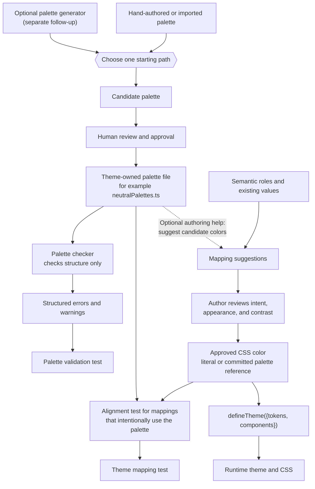

# Approved palette authoring contract

## Intent

让持续维护的主题拥有一份一致、可审查的颜色参考，同时不把这份参考变成运行时主题契约的一部分。

主题可以把一份已批准的调色板保存在主题自有的源文件中。作者与工具可以用它来挑选和审查明确的主题颜色。`defineTheme()` 仍然只接收那些控制渲染输出的明确值；它不接收、不继承、不校验、不发布也不解析调色板数据。

语义令牌仍然是组件与应用的主要接口。调色板是颜色决策与对比度测试的起点，而不是宣称每个组件上下文都已通过无障碍要求。

“已批准”意味着该调色板已由其所属主题有意评审过。结构校验不授予设计批准，也不证明对比度合格。

## Terminology

- 一个主题可以拥有一份**调色板映射**。
- 该映射包含具名的**族**，例如 `neutral`、`red` 或 `blue`。
- 一个族至少包含一个特定模式的**色阶**：亮色、暗色，或两者兼有。
- 一个色阶包含一个或多个由作者定义的数值**停靠点**。停靠点标签是包含范围 `0` 到 `100` 内的有限 JSON 数字；整数与小数标签均有效，诸如 `5` 与 `5.0` 这样的等价写法指向同一个停靠点。不同调色板可以使用不同的停靠点布局，以适应 UI、图标、插画、数据可视化或品牌工作。
- 一个**明确的主题颜色**要么是字面 CSS 颜色，要么是对主题已提交调色板文件中某一个确切值的有意引用。在这两种情况下，`defineTheme()` 接收的都是解析后的 CSS 值，而不是调色板元数据。
- 一次**对齐检查**把有意由调色板支撑的主题颜色与其被选取的已批准调色板停靠点进行比较。

## Authoring flow

调色板文件仍可供后续创作与审查使用。它在建议生成之后并不会消失。映射建议是可选的，且绝不能自动改写主题。作者会审查每一个被选取的颜色，并要么直接保存其 CSS 值，要么从已提交的调色板文件中引用该确切值。因此，修改一个被引用的值就是一次有意的、可审查的主题变更。

## Non-goals

- 在 `DefineThemeInput` 或 `DefinedTheme` 中加入调色板。
- 改变颜色展开、继承、运行时 CSS 或静态主题构建。
- 要求每个主题都维护一份调色板。
- 要求每个主题颜色都匹配某个调色板停靠点。
- 把停靠点当作语义角色或无障碍保证。
- 在本次变更中把调色板文件作为运行时包产物发布。
- 在本次变更中生成调色板或映射建议。
- 为未来的调色板生成器选择算法或生产 API。

## Requirements

- **FR1 — 调色板采用是可选的。** 持续维护的主题可以保留一份主题自有的调色板文件。没有调色板文件的主题保持其现有的创作、运行时、构建、继承与打包行为。采用调色板不得使其成为 `defineTheme()` 的必填字段。
- **FR2 — 调色板仅是创作期数据。** 调色板数据必须保持在 `DefineThemeInput`、`DefinedTheme`、运行时提供者、生成的 CSS 以及通用的 `astryx theme build` 输出之外。它可以与其主题放在一起，也可以从另一个创作源导入。本契约不要求某一种仓库布局，但每份持续维护的调色板必须有明确的所有者。主题自有的调色板必须对该主题保持私有，除非某个独立的公共 API 明确为其族与停靠点键承担兼容性义务。
- **FR3 — 声明的色阶使用明确、由作者定义的形态。** 调色板映射必须包含至少一个具名族。每个族必须声明一个非空的亮色色阶、一个非空的暗色色阶，或两者兼有。缺失的模式不得被推断。诸如 Gothic 的主题可以只声明暗色色阶，而诸如 Stone 的主题可以只维护一个族。共享的色阶必须被显式分配给两种模式。每个色阶定义自己严格递增的停靠点标签与不透明的六位十六进制值。标签必须是 `0` 到 `100` 之间的有限 JSON 数字，在数值归一化后唯一，且严格递增。端点 `0` 与 `100` 是可选的，单停靠点色阶也是有效的。本契约不得要求 11 个、21 个或任何其他固定的停靠点数量。生成器可以推荐一种默认布局，但不得把该布局变成有效性规则。可选的 hue、chroma、purpose 与 description 字段仅是元数据。
- **FR4 — 校验是显式且非变异性的。** 调色板检查器必须检查已声明的数据，而不定义、归一化、生成或返回一个替代调色板。它必须用稳定的路径与消息报告所有结构性问题。结构性错误包括空调色板、空色阶、重复或无效的停靠点标签（包括非有限值、超出 `0..100` 的值、诸如 `5` 与 `5.0` 的非唯一数值，或并非严格递增的标签）、格式错误的颜色以及无效的模式形态。检查器必须校验作者声明的停靠点布局，而不是要求一份通用的停靠点清单。它不得从 `defineTheme()`、运行时提供者或通用主题构建中运行。公共检查器或 CLI 需要自己的已接受 API 契约。
- **FR5 — 主题选择保持明确。** 作者与工具可以使用调色板来建议或选择颜色。主题映射可以字面保存所接受的 CSS 颜色，也可以有意从其已提交的调色板文件中引用该确切值。引用必须在运行时输出之前解析为受支持的 CSS 值，且不得让 `defineTheme()` 感知调色板族或停靠点。重命名或移除被引用的停靠点必须使类型检查、校验或主题构建失败。修改被引用的值是一次有意的主题变更，必须连同其渲染影响一起评审。
- **FR6 — 校验与对齐是分开的检查。** 采用主题必须测试其调色板没有结构性错误。它应当单独测试那些有意从调色板停靠点中选取的主题映射。对齐测试不得暗示每个直接主题颜色都是违规。Alpha 叠加层、品牌色、合成色以及针对对比度的特定调整可以作为有意的偏离而保留。
- **FR7 — 无障碍仍是上下文相关的。** 一份结构有效的调色板或一个对齐的映射，并不证明某对前景/背景、交互状态或组件通过 WCAG。所属主题必须在其打算支持的实际组件上下文中测试对比度。
- **FR8 — 生成是一项独立能力。** 未来的生成器或 CLI 可以创建候选调色板文件或映射建议。该工作必须有自己的已接受契约与评审。生成输出在被主题作者审查并采用之前仍是候选；仅仅添加调色板不得触发自动的最近颜色替换。

## Handling existing and intentional differences

本契约仅在主题选择采用调色板形态时适用。它不会追溯性地否决无关主题或其现有的颜色系统。

校验器把已声明的契约与主题用法区分开来：

- 无效的调色板容器、格式错误的颜色、重复或无效的停靠点标签、空色阶，或两种模式皆无的族，都是结构性错误。
- 仅亮色、仅暗色、双模式、单族与多族调色板都是受支持的形态，而不是例外。
- 调色板之外的颜色不是校验器错误，因为校验器不检查主题令牌或组件。
- 当调色板包含中性族时，作者应当把该族用于近黑、近白以及其他无彩色 UI 角色。确切的黑色与白色仍是普通的明确主题值，而不是必需的族端点。这是创作指导，而非结构校验规则。
- 有意的映射差异在所属主题的对齐测试中处理：更新主题、保留并记录明确的偏离，或回退调色板变更。

未来的仓库工具可能会在持续维护的调色板针对真实模式完成审计之后增加警告。它不得在未先把该模式加入契约或记录一个窄范围例外的情况下，就把一种有意的既有模式变成硬性失败。

## Current-state impact

当前的 `main` 存储明确的主题颜色，且在归一化的主题契约中没有调色板字段。本提案保留该行为。

Neutral 是计划在单独后续工作中采用的第一个采用方。它的调色板可以放在主题自有的私有 TypeScript 文件中，而 `neutralTheme.ts` 显式引用那些解析为 CSS 颜色的已评审值。该采用需要自己的视觉评审、测试、主题记录与发布处理，而不是从本契约获得隐式批准。

现有的 sandbox 生成器仍是有用的设计证据。生产生成器被有意推迟到一份单独的提案，该提案将参考 sandbox 与 PR #5800 中的讨论。

## Verification

本次仅涉及规格的变更运行仓库知识检查，不改变任何包、运行时、构建、主题或公共 API 行为。后续实现必须证明调色板创作仍处于运行时主题契约之外，并只测试它们明确支持的调色板形态。

## Decision log

### DEC-1 — Palettes guide consistency without enforcing it

**引用：** `spec:AST-018/DEC-1`

**决策者：** `rubyycheung`，`2026-09-02`

主题可以使用调色板来建立一致的颜色表达，但采用与用法仍是可选的。优先使用语义令牌，而有意的直接颜色仍然有效。

已否决：要求每个主题或每个颜色都使用调色板。那会把创作指导变成运行时策略，并错误地描述合法的叠加层、品牌色与针对对比度的特定值。

### DEC-2 — Palette data stays outside the runtime theme contract

**引用：** `spec:AST-018/DEC-2`

**决策者：** `rubyycheung`，`2026-09-03`

调色板文件是主题自有的创作参考。`defineTheme()` 不接收、不校验、不保留、不继承也不发布它们。这遵循 `architecture:theme-authoring-contract`：仅用于校验的数据不进入归一化的运行时主题。

已否决：在 `DefineThemeInput` 或 `DefinedTheme` 上增加 `palettes` 字段。它增加了运行时兼容性成本，却不构造任何运行时值。

### DEC-3 — Validation reports; it does not define or prescribe a stop count

**引用：** `spec:AST-018/DEC-3`

**决策者：** `rubyycheung`，`2026-09-03`

调色板校验报告结构性错误，而不把未改变的调色板当作构造出的新值返回。它校验作者声明的停靠点布局，而不是规定 11 或 21 个停靠点。主题包测试或已接受的未来 CLI 决定校验结果如何影响 CI。

已否决：Core 的 `defineTonalPalettes()` 或 `validateTonalPalettes()` 导出。根据 `spec:AST-002/FR17` 与 DEC-7，`define*` 辅助函数必须构造或归一化一个持久的受支持值，而仅用于校验的创作期数据不属于 Core 运行时契约。

### DEC-4 — Theme mappings explicitly select reviewed CSS values

**引用：** `spec:AST-018/DEC-4`

**决策者：** `rubyycheung`，`2026-09-03`

基于调色板的映射是创作决策。一旦批准，主题可以字面保存所选 CSS 值，也可以有意从其私有的已提交调色板文件中引用该确切值。后者使调色板成为唯一事实来源：修改它就是一次可见的、影响主题的源变更，而缺失的引用会失败而不是回退。两种形式都不会给 `defineTheme()` 或运行时输出增加调色板语义。

已否决：在普通主题构建期间重新运行生成，以及自动的最近颜色替换。二者都可能在没有对已提交调色板或主题源做已评审编辑的情况下改变渲染颜色。

### DEC-5 — Neutral's remap is a contrast-testing baseline

**引用：** `spec:AST-018/DEC-5`

**决策者：** `rubyycheung`，`2026-09-02`

Neutral 已批准的调色板与显式重映射为未来的颜色决策与组件对比度测试提供了一个锚点。批准并不宣称每个现有组件、模式或交互状态都已通过无障碍要求。

已否决：把完整的组件级一致性作为调色板的前提。调色板是用于发现并修复这些上下文问题的基线。

### DEC-6 — Supported modes are explicit

**引用：** `spec:AST-018/DEC-6`

**决策者：** `rubyycheung`，`2026-09-03`

一个族声明亮色、暗色或两种色阶。缺失的模式不会被推断。这支持诸如 Gothic 的仅暗色主题与诸如 Stone 的单族主题，而不假装它们拥有不同的模式或清单。

### DEC-7 — Palette generation is follow-up work

**引用：** `spec:AST-018/DEC-7`

**决策者：** `rubyycheung`，`2026-09-03`

本提案校验已采用的调色板文件。生产生成器以及任何用于创建或映射建议的 CLI 命令都需要单独的提案。现有的 sandbox 原型与 PR #5800 是那份未来设计的输入，而不是本契约中的运行时依赖或已接受 API。

### DEC-8 — Stop layouts belong to palette authors

**引用：** `spec:AST-018/DEC-8`

**决策者：** `rubyycheung`，`2026-09-03`

本契约接受任何非空的、由作者定义的停靠点布局，只要其有限数值标签唯一、严格递增且处于 `0..100` 之内。未来的 Astryx 生成器可以默认使用 21 个停靠点以获得更细的创作选择，但 11 个停靠点、单个停靠点，或面向图标、插画、可视化或品牌工作的专用调色板同样有效。输入要求更窄的工具必须在本地声明并校验这些要求，而不是重新定义调色板的有效性。

已否决：要求每份调色板都包含两个端点，或固定为五之类的增量。那会把某个生成器的默认值变成对无关创作需求的不必要限制。

## Open questions

无。
